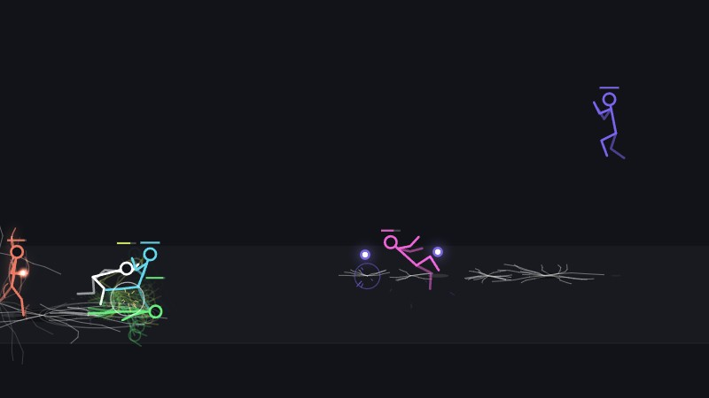

# Stickman Brawl 火柴人格鬥

A comic-style stickman brawl for [Wallpaper Engine](https://www.wallpaperengine.io/).
Fighters mix boxing, Muay Thai, taekwondo, judo and wrestling with comic
specials: energy blasts, wall running, and hits that slam them into walls. A
knockout turns the loser into a ragdoll, and a new round starts when one side
is left.

## Install

1. Download or clone this repository.
2. In Wallpaper Engine, choose **Open Wallpaper → Open from File** and pick
   `project.json`.

## Settings

The settings panel is available in English, Traditional Chinese and
Simplified Chinese. It sets the number of fighters (2 to 16), free-for-all or
red vs blue teams, speed, figure size, which fighting styles are used, health
bars, per-fighter colors, and the background and line colors.

Opened in a plain browser, `index.html` also reads `count`, `mode` and `speed`
from the query string, for example `index.html?count=8&mode=teams`.

## Development

There is no build step: `index.html` loads `main.js` directly. See
[AGENTS.md](AGENTS.md) for the commands and rules, and
[CONTRIBUTING.md](CONTRIBUTING.md) before opening a pull request.

## License

[MIT](LICENSE)
