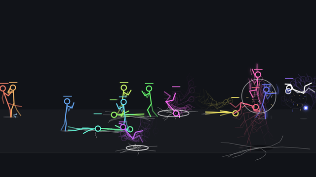
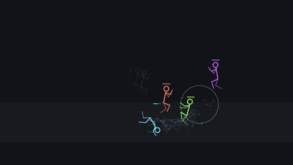
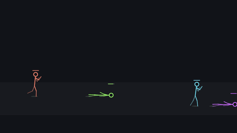
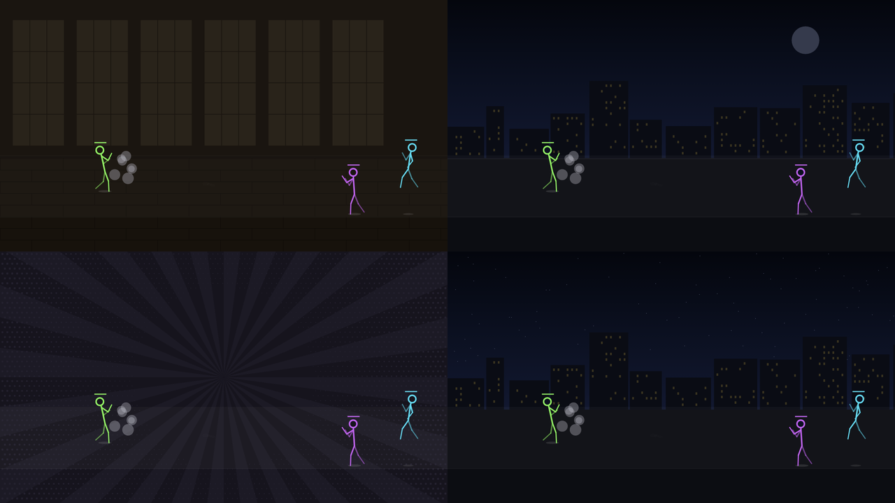
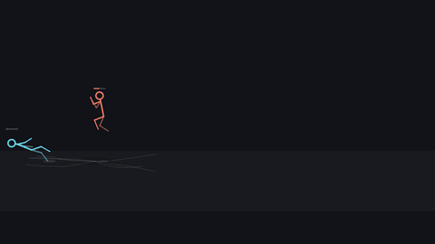
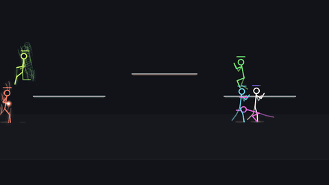
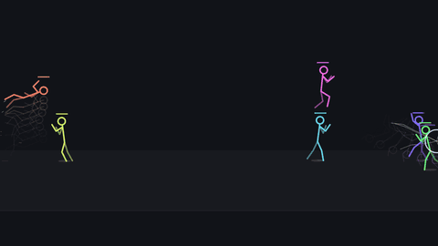

# Stickman Brawl 火柴人格鬥

English | [繁體中文](README.zh-TW.md) | [简体中文](README.zh-CN.md)

A comic-style stickman brawl for [Wallpaper Engine](https://www.wallpaperengine.io/).
Fighters mix boxing, Muay Thai, taekwondo, judo and wrestling with comic
specials (energy blasts, wall running, and hits that slam them into walls),
magic (fireballs, lightning strikes, ice shards that freeze the target, and
shields that stop a hit) and ninjutsu: shuriken, shadow clones, smoke escapes,
and a log left behind to take a hit. A punch or kick that lands can run
straight on into the next, in combos of up to four strikes. A knockout turns
the loser into a ragdoll, and a new round starts when one side is left.

## Install

Subscribe to it on the
[Steam Workshop](https://steamcommunity.com/sharedfiles/filedetails/?id=3845187060),
and Wallpaper Engine downloads it.

To run it from this repository instead:

1. Download or clone this repository.
2. In Wallpaper Engine, choose **Open Wallpaper → Open from File** and pick
   `wallpaper/project.json`. The `wallpaper/` folder holds only the files the
   wallpaper needs, so a Workshop upload from it leaves out the rest of the
   repository.

## Settings

The settings panel is available in English, Traditional Chinese and
Simplified Chinese. The pictures below come from the wallpaper itself; see
[AGENTS.md](AGENTS.md) for how they are recorded.

### Fighters, mode, speed and size

The panel sets the number of fighters (2 to 16), free-for-all or red vs blue
teams, the game speed, and the figure size (50% to 200%).

### Fighting styles

Each of the eight styles can be turned off: boxing, Muay Thai, taekwondo,
judo, wrestling, specials, magic and ninjutsu. With every style turned off,
fighters use all five martial-arts styles, without the specials, magic or
ninjutsu. Below, specials only, magic only and ninjutsu only.

### Health bars and colors

"Show health bars" draws a bar over each fighter, and "Unique color per
fighter in free-for-all" gives each fighter its own color. Below, both on, then both
off.

### Reduce flashing and screen shake

"Reduce flashing and screen shake" is on by default: it hides the
full-screen white flash of energy blasts and lightning and the speed lines of
big hits, and stops the screen shaking. Turn it off for the full comic look,
as below.

### Show score

"Show score" (off by default) keeps a running tally of round wins in the top
left corner: `RED 5 : 3 BLUE` in teams mode, or the top three fighters as
`#3 ×4  #1 ×2` in free-for-all. Draws are not counted, and the tally starts
over when the number of fighters or the mode changes.

### Fighter names and head gear

"Fighter names" takes comma-separated names, given to fighters in order
(`Ann, Bo, Cy`): a named fighter shows its name above its health bar and in
the win text (`ANN WINS!`). Names are cut to 12 characters, and an empty entry
keeps `#n`. "Head gear" gives each fighter a headband, ninja mask, cap or
topknot, the same one every round. Both are off by default.

### Background

"Background" draws a dark scene behind the fight in place of the flat
background color: a dojo, a rooftop at night, comic halftone dots, or a sky
that follows the local clock from dawn to night. All of them are drawn in
code. The default, Plain, keeps the flat color.

The day and night sky at 6:00, 12:00, 18:00 and 23:00:

### Background and line colors

With the Plain background, "Background color" and "Line color" set the flat
background and the color of the lines; with "Unique color per fighter" off,
the fighters are drawn in the line color too.

### Slow-motion finish

"Slow-motion finish" (off by default) slows the fight to a quarter speed for
about a second when the knockout that ends a round lands, and zooms in on the
fighter knocked out. With "Reduce flashing and screen shake" on, the fight
still slows but the view does not move.

### Round rules

"Round rules" varies the rounds; Normal, the default, plays them as before.
King gives one fighter a round double health and a crown, and everyone else
goes after it first. Ladder turns a free-for-all into one-on-one fights: the
rest wait at the sides cheering, the winner stays and the next steps in. After
a double knockout the next two step in; if only one is left waiting, it has
nobody to fight and the round is a draw.
Survival lets a round's winners keep their health into the next round, unless
it is below 15%; a round that times out, or that a settings change starts over,
restores everyone. King and Ladder apply to free-for-all only.

### Items

"Items" (off by default) drops a staff, a boomerang or a heart from the top of
the screen every 8 to 15 seconds, at most two at a time, and fighters with no
enemy close walk over to pick them up. A staff makes its holder's next three
strikes reach farther and hit harder, a boomerang is thrown once and flies out
and back (a block or shield stops it), and a heart restores 30% health. Items
vanish when a round ends. A staff follows the style switches: with boxing, Muay
Thai and taekwondo all off, fighters leave it on the floor and drop one they
hold, and a staff strike keeps the style of the kick or punch it replaces.

### Floating platforms

"Floating platforms" adds two or three thin ledges above the floor. The middle
one needs a wide world: a 16:9 screen at 100% figure size has three, while a
narrow world, from a 5:4 or portrait screen or a large figure size, has only
the two side ledges, set lower at large figure sizes. Fighters land on them,
walk off their edges, and jump up or drop down to reach an opponent on
another level. Slams, dives and wall-run leaps land on a ledge too, and a
slam's shockwave hits the fighters on the ledge it lands on, not those on the
floor below, and one landing on the floor does not reach those on a ledge.
Shots and energy beams coming down stop at a ledge, as lightning does, while
those fired from below pass up through it. With Items on too, an item can
land on a ledge, and fighters standing on that ledge pick it up. It is off by
default.

### Sound effects

"Sound effects" plays short comic sounds for hits, blocks, specials,
knockouts and the end of a round, with its own volume. It is off by default.
The sounds are made in code when they play, so the wallpaper loads no audio
files and works offline.

### React to music

"React to music", off by default, listens to the audio playing on the desktop
through Wallpaper Engine: bass beats and loud passages make fighters attack
sooner and pick specials more often, and with "Reduce flashing and screen
shake" off a beat also makes the lines glow. "Music reaction strength" sets
how much; game speed never changes, and a few seconds of silence bring the
fight back to normal. A plain browser has no such audio, so nothing changes
there. Below, a beat twice a second at full strength.

### Click to blast

"Click to blast", off by default, makes a click on the wallpaper burst with
an impact and a crack and throw the fighters near it away from it; knocked-out
bodies are pushed too. It deals no damage, and clicks within half a second of
one are ignored.

### In a browser

Opened in a plain browser, `wallpaper/index.html` also reads `count`, `mode`,
`speed`, `reducemotion`, `sound` and `volume` from the query string, for
example `index.html?count=8&mode=teams` or `index.html?sound=1&volume=50`.
`count` (2 to 16), `speed` (0.25 to 3, where 1 is 100%) and `volume` (0 to
100) are clamped to the panel's ranges and must be plain decimal numbers
(`0x10` or `1e1` keeps the default), `mode` is `ffa` or `teams` in any case,
`reducemotion` and `sound` are turned on by `1`, `true`, `on` or `yes` and off
by `0`, `false`, `off` or `no` (in any case), and any other value keeps the
default. A browser plays sound only after the page has
been clicked once.

## Development

There is no build step: `wallpaper/index.html` loads `wallpaper/main.js`
directly. See [AGENTS.md](AGENTS.md) for the commands and rules, and
[CONTRIBUTING.md](CONTRIBUTING.md) before opening a pull request.

## License

[MIT](LICENSE)
