# Stickman Brawl 火柴人格斗

[English](README.md) | [繁體中文](README.zh-TW.md) | 简体中文

给 [Wallpaper Engine](https://www.wallpaperengine.io/) 用的漫画风火柴人格斗壁纸。
角色混用拳击、泰拳、跆拳道、柔道和摔跤，加上漫画式必杀技（气功波、飞檐走壁、
把对手打到撞墙）、魔法（火球、雷击、把对手冻住的冰锥、挡下一击的护盾），以及忍术：
手里剑、影分身、烟遁，还有留下木头替身挨打的替身术。拳脚打中后可以直接接下一招，
两到三招连成一套连续技。两招在半空中对撞时双方都会被震开，
抓准时机的格挡能把攻击拨开并立刻反击。双方也会绕圈、保持一臂之遥对峙，再突然冲上去。
被击倒的一方会变成布娃娃，场上只剩一方时开始新的回合。

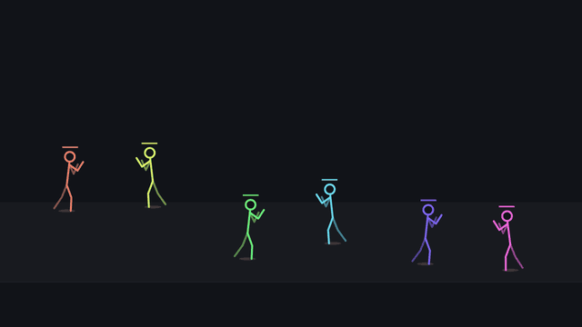

## 安装

在 [Steam 创意工坊](https://steamcommunity.com/sharedfiles/filedetails/?id=3845187060)
订阅，Wallpaper Engine 就会自动下载。

想直接从这个仓库运行：

1. 下载或 clone 这个仓库。
2. 在 Wallpaper Engine 选 **Open Wallpaper → Open from File**，选
   `wallpaper/project.json`。`wallpaper/` 文件夹只放壁纸需要的文件，所以从这里上传到
   创意工坊时不会带上仓库的其他内容。

## 设置

设置面板有英文、繁体中文和简体中文。下面的图片都是壁纸本身的画面，录制方式见
[AGENTS.md](AGENTS.md)。

### 人数、模式、速度与大小

面板可以设置人数（2 到 16 人）、“大乱斗”或“红蓝两队”、游戏速度，以及火柴人大小
（50% 到 200%）。

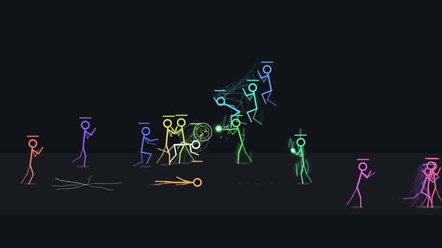
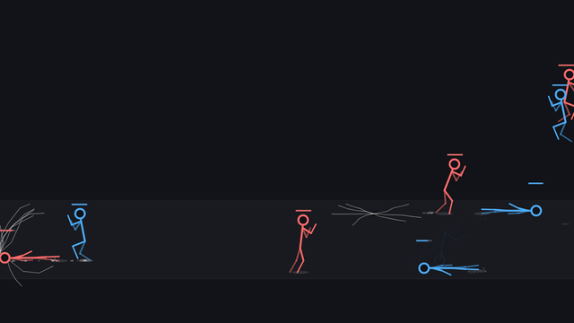

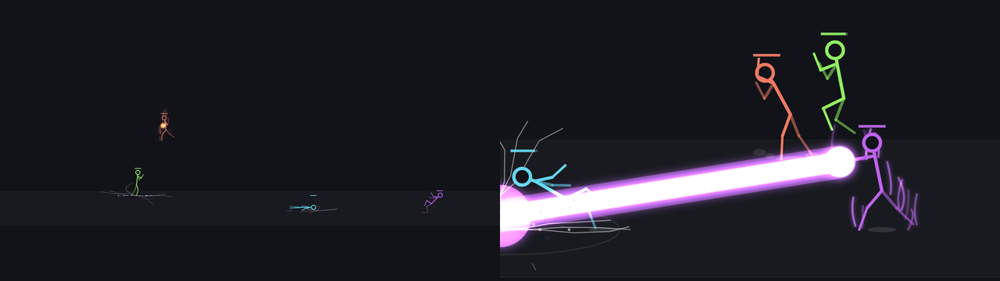

### 招式流派

八种流派都可以单独关掉：拳击、泰拳、跆拳道、柔道、摔跤、必杀技、魔法和忍术。
全部关掉时，角色会使用五种武术的所有招式，但不用必杀技、魔法和忍术。下面依次是
只开必杀技、只开魔法、只开忍术。

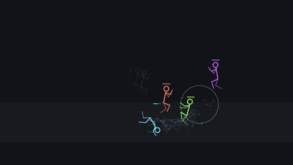
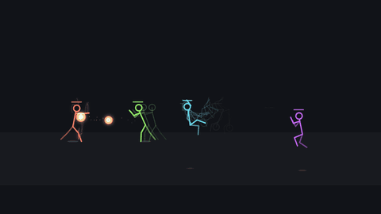
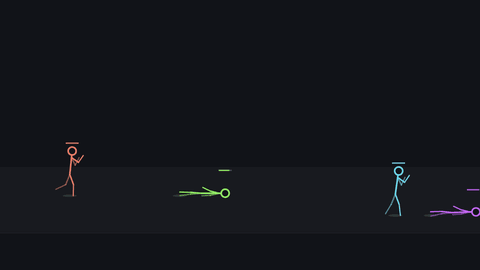

### 血条与颜色

“显示血条”会在每个角色头上画一条血条，“大乱斗时每人不同颜色”让每个角色有自己的
颜色。下图左边两者都开，右边都关。

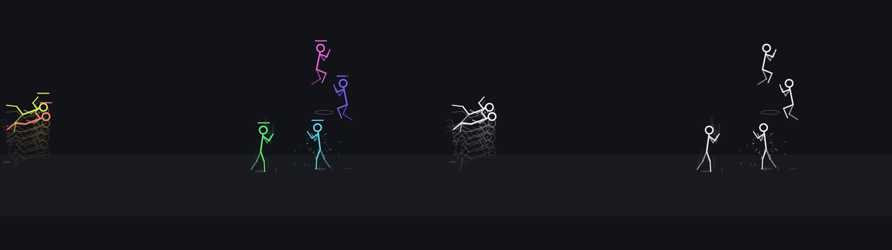

### 减少闪光与画面震动

“减少闪光与画面震动”默认开启：它会隐藏气功波和雷击的全屏白色闪光、重击和冲刺的速度线，
并停止画面震动。关掉它就是完整的漫画效果，如下图。

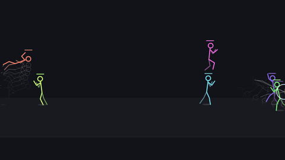

### 显示比分

“显示比分”（默认关闭）在左上角累计每回合的胜场：红蓝两队时显示 `RED 5 : 3 BLUE`，
大乱斗时显示前三名，例如 `#3 ×4  #1 ×2`。平局不计，人数或模式改变时重新计算。

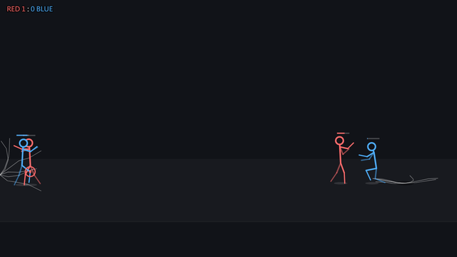

### 角色名称与头饰

“角色名称（以逗号分隔）”按顺序分给各个角色（`Ann, Bo, Cy`）：有名字的角色会在血条
上方和胜利文字中显示名字（`ANN WINS!`）。名字最多 12 个字符，留空的位置保持 `#n`。
“头饰”让每个角色戴上头带、蒙面、帽子或发髻，每回合都一样。两者默认都关闭。

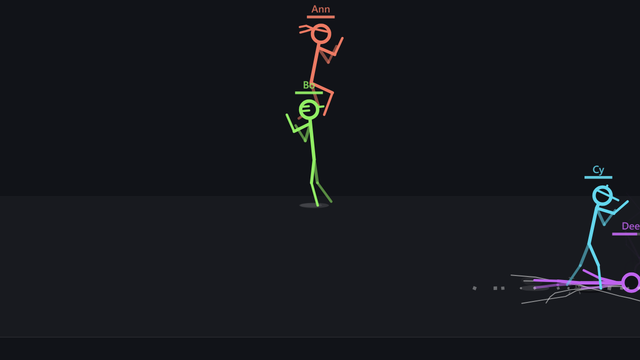

### 背景主题

“背景主题”在打斗后方画上深色场景，取代纯色背景：道场、夜晚屋顶、漫画网点，或是
依照本地时钟从清晨变到深夜的天空。全部用代码画出来。默认的“纯色”保持单一颜色。

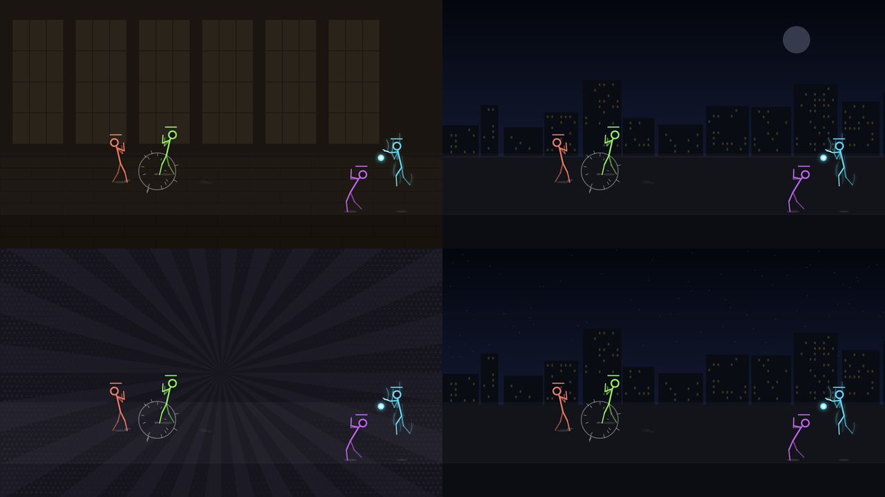

日夜变化在 6:00、12:00、18:00 和 23:00 的天空：

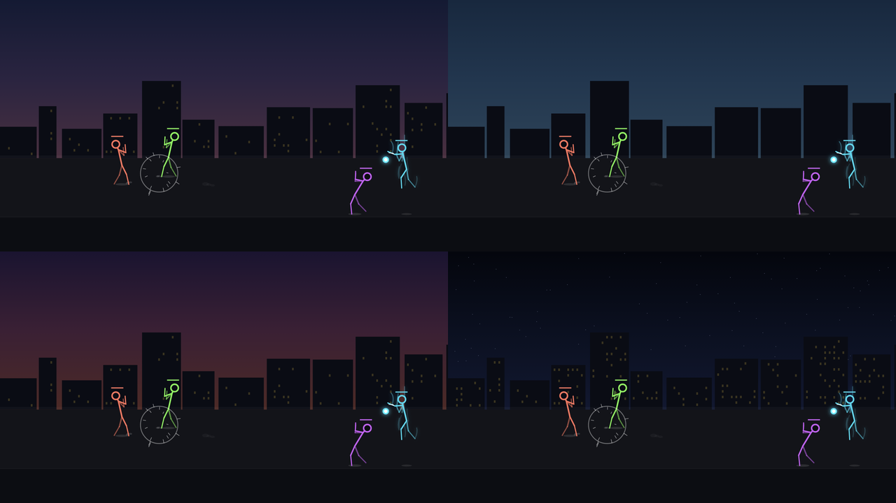

### 背景颜色与线条颜色

背景主题选“纯色”时，“背景颜色”设置背景的颜色。“线条颜色”在任何背景下都设置
线条的颜色；关掉“大乱斗时每人不同颜色”后，角色也用线条颜色画。

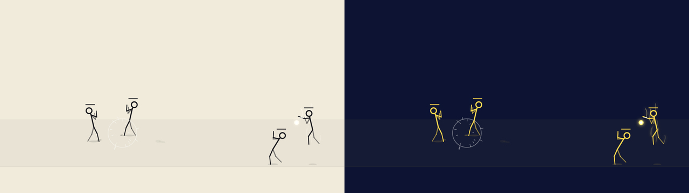

### 最后一击慢动作

“最后一击慢动作”（默认关闭）在决定回合胜负的那一击命中时，让打斗慢到四分之一速度
约一秒，并拉近被击倒的角色。开着“减少闪光与画面震动”时，打斗一样会变慢，但镜头
不会移动。

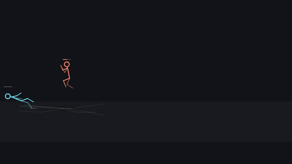

### 回合规则

“回合规则”改变回合的玩法；默认的“普通”照原来的方式进行。“王者”让一个角色在该
回合有两倍血量并戴上王冠，其他人会先围攻它。“车轮战”把大乱斗变成一对一：其他人在
两侧等待欢呼，胜者留下，下一位上场。双方同时倒下时换下两位上场；如果只剩一位在等，
它没有对手，这回合算平局。“生存”让回合胜者把剩下的血量带到下一回合，但低于 15% 时
会补满；回合时间到，或因为改设置而重新开始的回合，所有人都会补满。“王者”和“车轮战”
只在大乱斗时有效。

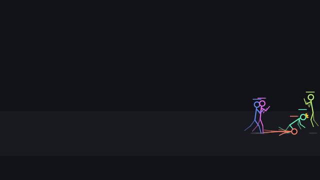
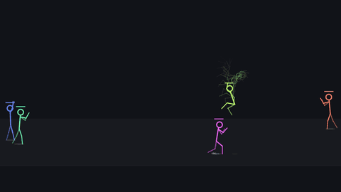

### 道具

“道具（长棍、回旋镖、爱心）”（默认关闭）每 8 到 15 秒从画面上方掉下一根长棍、一个
回旋镖或一颗爱心，同时最多两个，附近没有敌人的角色会走过去捡。长棍让持有者接下来三次
攻击打得更远、更痛；回旋镖扔出一次，飞出去再飞回来（格挡或护盾挡得住）；爱心恢复 30%
血量。回合结束时道具会消失。长棍会配合流派开关：拳击、泰拳和跆拳道都关掉时，角色不捡
长棍，手上有的也会扔掉；用长棍打出的攻击保持原来那一拳或那一脚的流派。

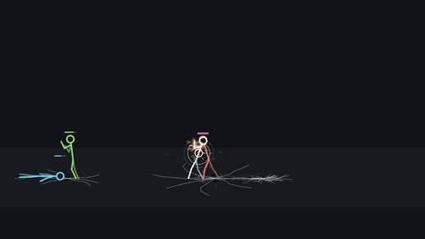

### 浮空平台

“浮空平台”在地面上方加两到三块薄平台。中间那块需要够宽的场地：16:9 屏幕、火柴人
大小 100% 时有三块；5:4、竖屏或火柴人较大时场地较窄，只有两侧的平台，火柴人很大时
平台也会放低。角色会落在平台上、从边缘走下来，也会跳上去或跳下来追另一层的对手。下砸、
俯冲和飞檐走壁的飞踢也会落在平台上；下砸落在平台上时，冲击波只打到同一块平台上的人，
打不到下方地面，落在地面上时也打不到平台上的人。从上方往下的射击和气功波会停在平台上，
雷击也一样；从下方往上射的则会穿过平台。同时开着道具时，道具可能落在平台上，由站在那块
平台上的角色捡起。默认关闭。

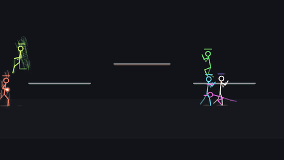

### 音效

“音效”为命中、格挡、必杀技、击倒和回合结束播放简短的漫画音效，有自己的音量设置，
默认关闭。音效在播放时才用代码合成，所以壁纸不加载任何音频文件，离线也能用。

### 随音乐律动

“随音乐律动”（默认关闭）通过 Wallpaper Engine 聆听桌面正在播放的声音：低音节拍和
响亮的段落会让角色更快出手、更常使用必杀技；关掉“减少闪光与画面震动”时，节拍也会让
线条发光。“音乐反应强度 (%)”设置反应的程度；游戏速度不会改变，安静几秒后打斗就会
恢复正常。普通浏览器没有这种音频，所以不会有变化。下图是强度 100%、每秒两拍的效果。

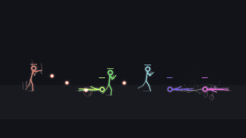

### 点击产生冲击波

“点击产生冲击波”（默认关闭）让点击壁纸的地方爆出冲击和裂痕，把附近的角色往外推开；
被击倒的身体也会被推动。它不造成伤害，上一次点击后半秒内的点击会被忽略。

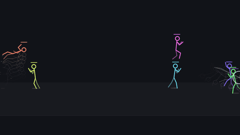

### 在浏览器中

用普通浏览器打开时，`wallpaper/index.html` 也会读取 URL 参数 `count`、`mode`、
`speed`、`reducemotion`、`sound` 和 `volume`，例如 `index.html?count=8&mode=teams`
或 `index.html?sound=1&volume=50`。`count`（2 到 16）、`speed`（0.25 到 3，1 代表
100%）和 `volume`（0 到 100）会限制在面板的范围内，而且必须是普通的十进制数字（`0x10`
或 `1e1` 会保持默认值）；`mode` 是 `ffa` 或 `teams`，不区分大小写；`reducemotion` 和
`sound` 用 `1`、`true`、`on` 或 `yes` 开启，用 `0`、`false`、`off` 或 `no` 关闭
（不区分大小写），其他值保持默认。浏览器要在页面被点击过一次之后才会播放声音。

## 开发

没有构建步骤：`wallpaper/index.html` 直接加载 `wallpaper/main.js`。命令与规则见
[AGENTS.md](AGENTS.md)，提 pull request 前请先看 [CONTRIBUTING.md](CONTRIBUTING.md)。

## 许可证

[MIT](LICENSE)
