# Stickman Brawl 火柴人格鬥

[English](README.md) | 繁體中文 | [简体中文](README.zh-CN.md)

給 [Wallpaper Engine](https://www.wallpaperengine.io/) 用的漫畫風火柴人格鬥桌布。
角色混用拳擊、泰拳、跆拳道、柔道和角力，加上漫畫式必殺技（氣功波、飛簷走壁、
把對手打到撞牆）、魔法（火球、雷擊、把對手凍住的冰錐、擋下一擊的護盾），以及忍術：
手裡劍、影分身、煙遁，還有留下木頭替身挨打的替身術。被擊倒的一方會變成布娃娃，
場上只剩一方時開始新的回合。

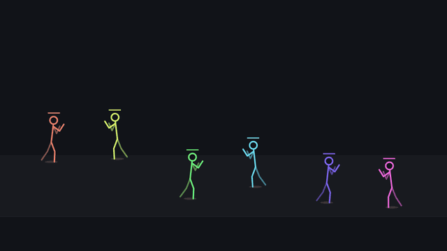

## 安裝

在 [Steam 工作坊](https://steamcommunity.com/sharedfiles/filedetails/?id=3845187060)
訂閱，Wallpaper Engine 就會自動下載。

想直接從這個 repository 執行：

1. 下載或 clone 這個 repository。
2. 在 Wallpaper Engine 選 **Open Wallpaper → Open from File**，選
   `wallpaper/project.json`。`wallpaper/` 資料夾只放桌布需要的檔案，所以從這裡上傳到
   工作坊時不會帶上 repository 的其他內容。

## 設定

設定面板有英文、繁體中文和簡體中文。下面的圖片都是桌布本身的畫面，錄製方式見
[AGENTS.md](AGENTS.md)。

### 人數、模式、速度與大小

面板可以設定人數（2 到 16 人）、「大亂鬥」或「紅藍兩隊」、遊戲速度，以及火柴人大小
（50% 到 200%）。

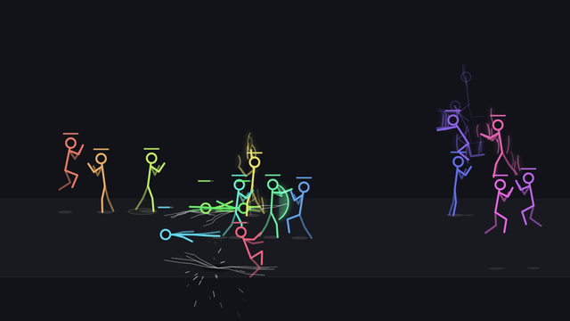
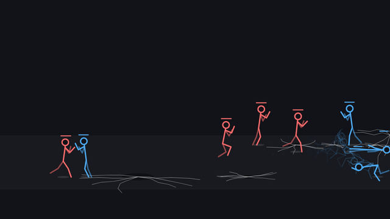

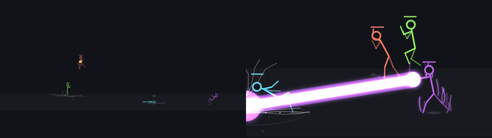

### 招式流派

八種流派都可以個別關掉：拳擊、泰拳、跆拳道、柔道、角力、必殺技、魔法和忍術。
全部關掉時，角色會使用五種武術的所有招式，但不用必殺技、魔法和忍術。下面依序是
只開必殺技、只開魔法、只開忍術。

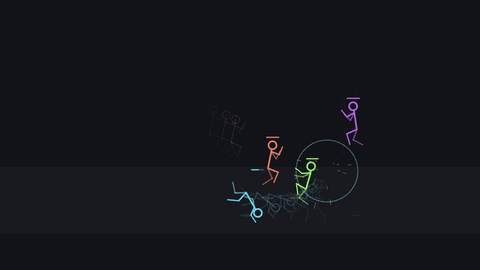
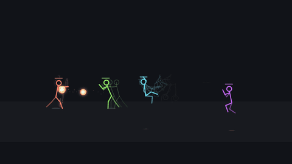
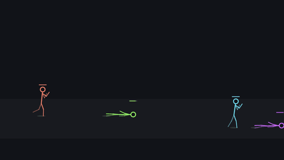

### 血條與顏色

「顯示血條」會在每個角色頭上畫一條血條，「大亂鬥時每人不同顏色」讓每個角色有自己的
顏色。下圖左邊兩者都開，右邊都關。

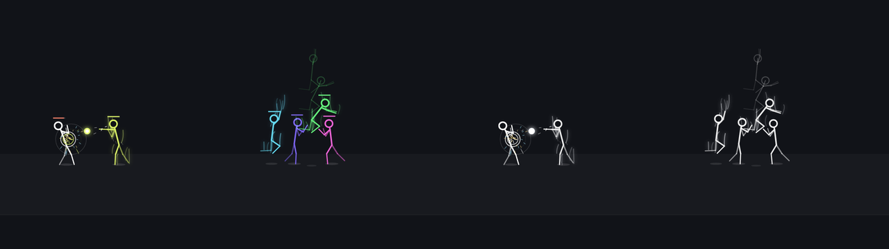

### 減少閃光與畫面震動

「減少閃光與畫面震動」預設開啟：它會隱藏氣功波和雷擊的全螢幕白色閃光、重擊的速度線，
並停止畫面震動。關掉它就是完整的漫畫效果，如下圖。

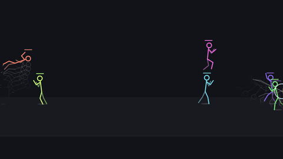

### 顯示比分

「顯示比分」（預設關閉）在左上角累計每回合的勝場：紅藍兩隊時顯示 `RED 5 : 3 BLUE`，
大亂鬥時顯示前三名，例如 `#3 ×4  #1 ×2`。平手不計，人數或模式改變時重新計算。

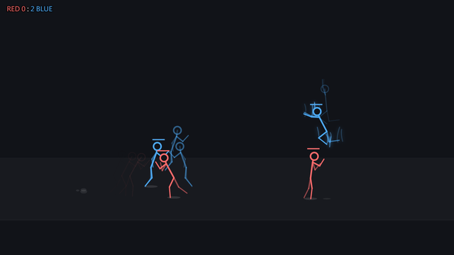

### 角色名稱與頭飾

「角色名稱（以逗號分隔）」依序分給各個角色（`Ann, Bo, Cy`）：有名字的角色會在血條
上方和勝利文字中顯示名字（`ANN WINS!`）。名字最多 12 個字元，留空的位置維持 `#n`。
「頭飾」讓每個角色戴上頭帶、蒙面、帽子或髮髻，每回合都一樣。兩者預設都關閉。

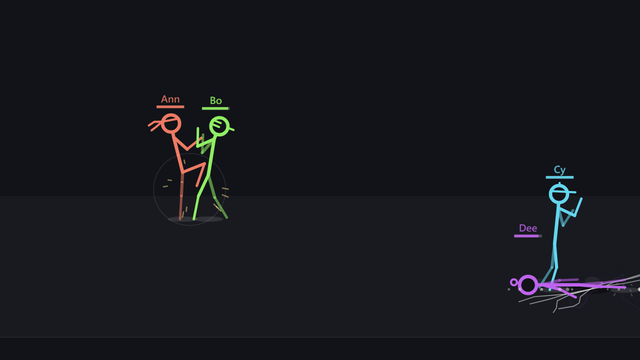

### 背景主題

「背景主題」在打鬥後方畫上深色場景，取代純色背景：道場、夜晚屋頂、漫畫網點，或是
依照本機時鐘從清晨變到深夜的天空。全部用程式畫出來。預設的「純色」維持單一顏色。

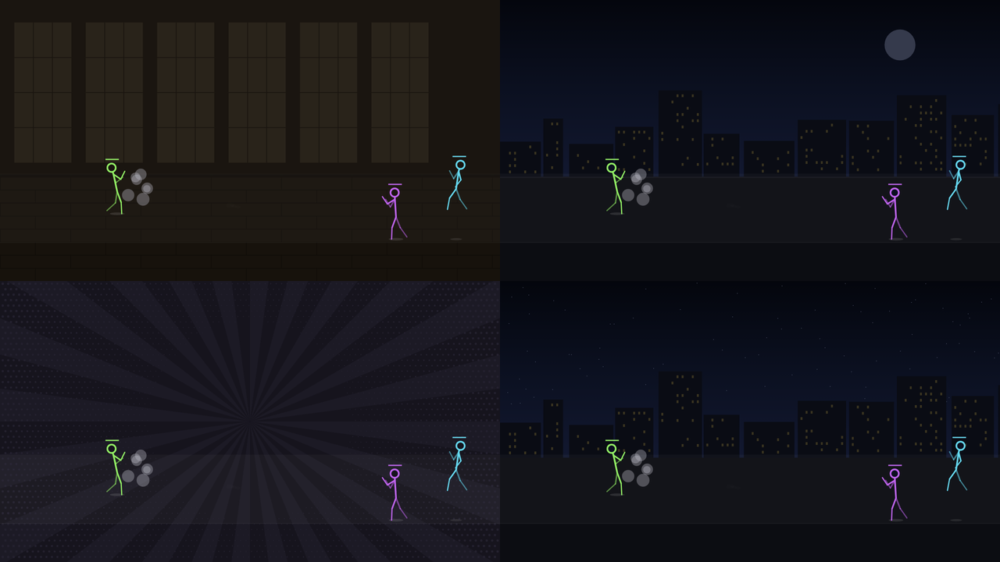

日夜變化在 6:00、12:00、18:00 和 23:00 的天空：

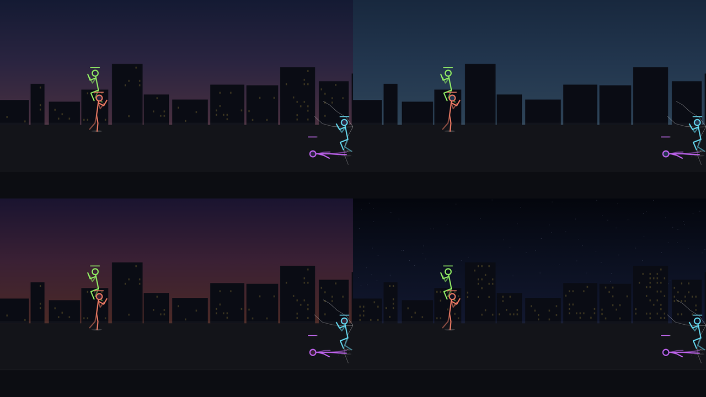

### 背景顏色與線條顏色

背景主題選「純色」時，「背景顏色」和「線條顏色」分別設定背景和線條的顏色；關掉
「大亂鬥時每人不同顏色」後，角色也用線條顏色畫。

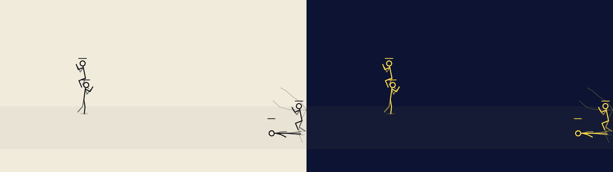

### 最後一擊慢動作

「最後一擊慢動作」（預設關閉）在決定回合勝負的那一擊命中時，讓打鬥慢到四分之一速度
約一秒，並拉近被擊倒的角色。開著「減少閃光與畫面震動」時，打鬥一樣會變慢，但鏡頭
不會移動。

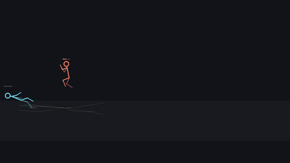

### 回合規則

「回合規則」改變回合的玩法；預設的「一般」照原本的方式進行。「王者」讓一個角色在該
回合有兩倍血量並戴上王冠，其他人會先圍攻它。「車輪戰」把大亂鬥變成一對一：其他人在
兩側等待歡呼，勝者留下，下一位上場。雙方同時倒下時換下兩位上場；如果只剩一位在等，
它沒有對手，這回合算平手。「生存」讓回合勝者把剩下的血量帶到下一回合，但低於 15% 時
會補滿；回合時間到，或因為改設定而重新開始的回合，所有人都會補滿。「王者」和「車輪戰」
只在大亂鬥時有效。

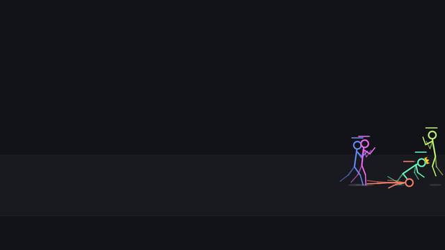
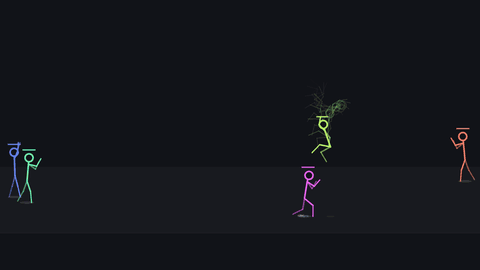

### 道具

「道具（長棍、迴力鏢、愛心）」（預設關閉）每 8 到 15 秒從畫面上方掉下一根長棍、一個
迴力鏢或一顆愛心，同時最多兩個，附近沒有敵人的角色會走過去撿。長棍讓持有者接下來三次
攻擊打得更遠、更痛；迴力鏢丟出一次，飛出去再飛回來（格擋或護盾擋得住）；愛心回復 30%
血量。回合結束時道具會消失。長棍會配合流派開關：拳擊、泰拳和跆拳道都關掉時，角色不撿
長棍，手上有的也會丟掉；用長棍打出的攻擊維持原本那一拳或那一腳的流派。

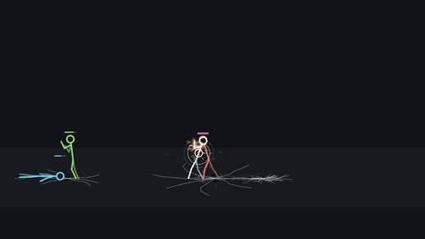

### 浮空平台

「浮空平台」在地板上方加兩到三塊薄平台。中間那塊需要夠寬的場地：16:9 螢幕、火柴人
大小 100% 時有三塊；5:4、直式螢幕或火柴人較大時場地較窄，只有兩側的平台，火柴人很大時
平台也會放低。角色會落在平台上、從邊緣走下來，也會跳上去或跳下來追另一層的對手。下砸、
俯衝和飛簷走壁的飛踢也會落在平台上；下砸落在平台上時，衝擊波只打到同一塊平台上的人，
打不到下方地板，落在地板上時也打不到平台上的人。從上方往下的射擊和氣功波會停在平台上，
雷擊也一樣；從下方往上射的則會穿過平台。同時開著道具時，道具可能落在平台上，由站在那塊
平台上的角色撿起。預設關閉。

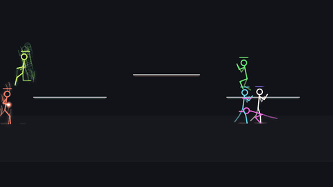

### 音效

「音效」為命中、格擋、必殺技、擊倒和回合結束播放簡短的漫畫音效，有自己的音量設定，
預設關閉。音效在播放時才用程式合成，所以桌布不載入任何音訊檔，離線也能用。

### 隨音樂律動

「隨音樂律動」（預設關閉）透過 Wallpaper Engine 聆聽桌面正在播放的聲音：低音節拍和
大聲的段落會讓角色更快出手、更常使用必殺技；關掉「減少閃光與畫面震動」時，節拍也會讓
線條發光。「音樂反應強度 (%)」設定反應的程度；遊戲速度不會改變，安靜幾秒後打鬥就會
恢復正常。一般瀏覽器沒有這種音訊，所以不會有變化。下圖是強度 100%、每秒兩拍的效果。

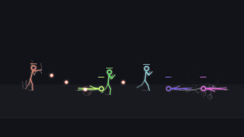

### 點擊產生衝擊波

「點擊產生衝擊波」（預設關閉）讓點擊桌布的地方爆出衝擊和裂痕，把附近的角色往外推開；
被擊倒的身體也會被推動。它不造成傷害，前一次點擊後半秒內的點擊會被忽略。

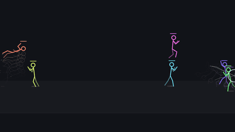

### 在瀏覽器中

用一般瀏覽器開啟時，`wallpaper/index.html` 也會讀取網址參數 `count`、`mode`、
`speed`、`reducemotion`、`sound` 和 `volume`，例如 `index.html?count=8&mode=teams`
或 `index.html?sound=1&volume=50`。`count`（2 到 16）、`speed`（0.25 到 3，1 代表
100%）和 `volume`（0 到 100）會限制在面板的範圍內，而且必須是一般的十進位數字（`0x10`
或 `1e1` 會維持預設值）；`mode` 是 `ffa` 或 `teams`，不分大小寫；`reducemotion` 和
`sound` 用 `1`、`true`、`on` 或 `yes` 開啟，用 `0`、`false`、`off` 或 `no` 關閉
（不分大小寫），其他值維持預設。瀏覽器要在頁面被點擊過一次之後才會播放聲音。

## 開發

沒有建置步驟：`wallpaper/index.html` 直接載入 `wallpaper/main.js`。指令與規則見
[AGENTS.md](AGENTS.md)，開 pull request 前請先看 [CONTRIBUTING.md](CONTRIBUTING.md)。

## 授權

[MIT](LICENSE)
